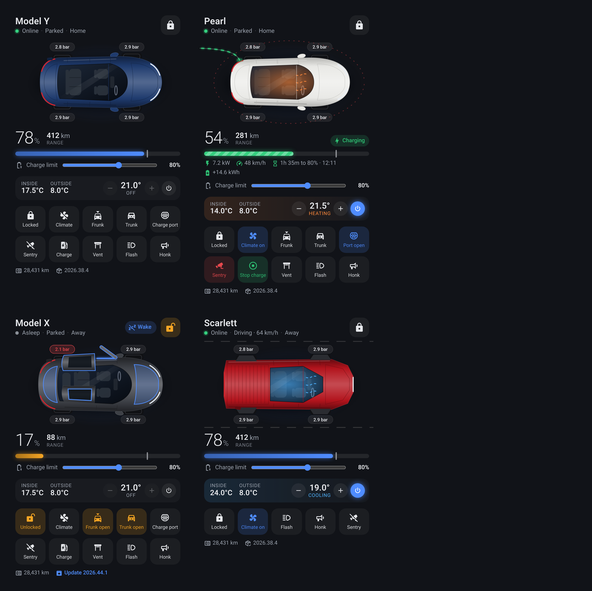

# 🚗 Teslemetry Card

[](https://hacs.xyz/docs/faq/custom_repositories/)
[](https://github.com/mimikm/Teslemetry-Card/releases)
[](https://github.com/mimikm/Teslemetry-Card/releases)
[](https://github.com/mimikm/Teslemetry-Card/actions/workflows/validate.yml)

A Home Assistant dashboard card for the [Teslemetry](https://www.home-assistant.io/integrations/teslemetry/) integration, built by **Dom** ([@mimikm](https://github.com/mimikm)).

See your Tesla at a glance: a live top-down drawing of your Model 3, Model Y, Model S, Model X or Cybertruck (or your own photo) with doors, frunk, trunk, windows, tyres, charging, climate and Sentry exactly as the car reports them, plus the controls you use every day.



---

## 🚧 Work in progress, fully functioning

The card is **fully functional** and ready to use on your dashboard. It's also a **work in progress**: new features arrive regularly, often based on what users ask for (a Powerwall energy card is next, see the [Roadmap](#️-roadmap)).

Found a problem or have an idea? [Open an issue](https://github.com/mimikm/Teslemetry-Card/issues/new/choose). For bugs, please include:
- Home Assistant version
- Card version (shown in the browser console on load)
- Your car model
- Your card configuration (YAML)
- The affected entities and what you expected to see

---

## ☕ Support the project

If you enjoy the card and want to support its development:

**[☕ Buy me a coffee](https://buymeacoffee.com/mimikm)**

Buying a Tesla or a Powerwall? Ordering through my referral link can earn referral credits for things like Supercharging, merchandise and accessories:

**[🚗 Tesla referral link](https://ts.la/dominik701995)**

Switching energy supplier? Joining **Octopus Energy** with my referral code gives us both credit, and costs you nothing:

**[🐙 Octopus Energy referral code](https://octopusreferralcode.com)**

---

## 📦 Installation

### HACS (recommended)

Teslemetry Card is installed through HACS as a **custom repository** for now (it's on its way to the HACS default store).

[](https://my.home-assistant.io/redirect/hacs_repository/?owner=mimikm&repository=Teslemetry-Card&category=plugin)

Click the button above and confirm adding the repository, or:
1. Open **HACS** in Home Assistant
2. Click **⋮ → Custom repositories**
3. Add `https://github.com/mimikm/Teslemetry-Card` with type **Dashboard**
4. Search for **Teslemetry Card**, open it and click **Download**
5. Reload your browser when asked
6. Add the card to a dashboard: **Edit dashboard → Add card** and search for "Teslemetry Card"

HACS adds the dashboard resource for you, and shows new versions under **HACS → Updates** (or in **Settings** next to other updates).

### Manual

1. Download `teslemetry-card.js` from the [latest release](https://github.com/mimikm/Teslemetry-Card/releases)
2. Copy it into `/config/www/`
3. Add a dashboard resource: **Settings → Dashboards → ⋮ → Resources** → `/local/teslemetry-card.js`, type **JavaScript module**
4. Add the card to a dashboard

> **Not seeing an update?** Browsers cache card files aggressively. Hard-refresh (Ctrl/Cmd+Shift+R), and on phones fully close and reopen the Home Assistant app.

### Requirements

- Home Assistant **2024.8** or newer
- The [Teslemetry integration](https://www.home-assistant.io/integrations/teslemetry/) set up with your vehicle

---

## ✨ Features

**🚘 Your car, drawn live**
- Top-down drawings of **Model 3, Model Y, Model S, Model X** (with falcon-wing doors) and **Cybertruck**, picked automatically from your vehicle or chosen from a drop-down
- Painted in your car's colour (read from the *Exterior color* sensor, or set your own)
- Doors swing open; windows, frunk, trunk and sunroof light up when open
- Charge cable appears when plugged in, with animated energy flow while charging
- Cabin glows orange or blue while climate is heating or cooling
- Sentry mode perimeter, headlight flash animation, moving road while driving
- Tyre pressures on each wheel by default, turning red on a TPMS warning
- Steering wheel and doors follow left- or right-hand drive

**🖼️ Or your own picture**
- Upload a photo straight from the card editor (or paste a URL); status chips, a tyre pressure panel and a charging glow sit around it

**🔋 Battery & charging**
- State of charge, range and charge-limit marker
- Charging power, rate, energy added, time to full and the clock time it finishes
- Charge limit slider, and an optional charge current slider

**🌡️ Climate**
- Inside and outside temperature, target temperature +/−, climate on/off

**🎛️ Quick controls**
- Lock, climate, frunk, trunk, charge port, Sentry, start/stop charging, vent windows, defrost, flash lights, honk, wake
- Unlocking and opening the frunk or trunk need a second tap within 4 seconds

**ℹ️ Status**
- Online/asleep, parked/driving with speed, location zone, a **Wake** chip when the car sleeps, odometer and software update

**⚙️ Easy setup**
- Finds your car automatically, no configuration needed
- Full visual editor
- Tap any value, tyre, door or lid to open its details
- Works with light and dark themes

---

## 🚘 Car pictures

Choose **Car picture** in the editor, or set `model` in YAML:

| `model` | Picture |
| --- | --- |
| `auto` (default) | Uses the model Teslemetry reports for your vehicle |
| `model_3` | Model 3 |
| `model_y` | Model Y |
| `model_s` | Model S |
| `model_x` | Model X, with falcon-wing doors |
| `cybertruck` | Cybertruck |
| `custom` | Your own picture (see below) |

The paint colour comes from the *Exterior color* sensor. To pick it yourself, set `car_color` (for example `#1f3b6e`).

---

## 🖼️ Your own picture

Pick **Custom picture** in the editor, then click **Upload picture** (or drop a file onto the upload box). The picture is stored in Home Assistant, so it works on every device. You can also paste a web URL or a `/local/` path instead. In YAML:

```yaml
type: custom:teslemetry-card
model: custom
image: /local/my-tesla.png
image_height: 200
```

A transparent PNG of your car side-on looks best. Put it in `/config/www/` and refer to it as `/local/...`, upload it in the editor, or use any web URL.

With your own picture, open doors, windows, frunk, trunk, Sentry and climate show as chips under the photo, with a tyre pressure panel below it.

---

## 💡 Getting the most out of it

Several Teslemetry entities are **disabled by default**. If the tyre pressure sensors are off, the card shows a reminder; tap it to jump straight to your car's device page. To light up everything on the card, enable these under **Settings → Devices & services → Teslemetry → your car**:

- *Exterior color* (paint colour)
- *Tire pressure* front/rear left/right, and the *Tire pressure warning* sensors
- *Front/Rear driver/passenger door* and *window*
- *Charge cable*
- *Inside temperature* and *Outside temperature*
- *Right hand drive*

Every button uses Teslemetry's normal actions, so the car wakes the same way it does with the built-in controls.

---

## 🛠 Example configuration

Minimal (one car, everything automatic):

```yaml
type: custom:teslemetry-card
```

Customised:

```yaml
type: custom:teslemetry-card
name: Model Y
model: model_y
accent_color: "#e31937"
drive_side: rhd
show_charge_current: true
actions:
  - lock
  - climate
  - frunk
  - trunk
  - charge_port
  - sentry
  - charge
  - flash
```

---

## 📋 Configuration options

| Option | Default | Description |
| --- | --- | --- |
| `device_id` | auto | Teslemetry vehicle device. If omitted, the first Teslemetry vehicle is used |
| `vehicle` | – | Alternative to `device_id`: the entity ID prefix, e.g. `my_tesla` for `sensor.my_tesla_battery_level` |
| `name` | device name | Card title |
| `model` | `auto` | Car picture: `auto`, `model_3`, `model_y`, `model_s`, `model_x`, `cybertruck` or `custom` ([Car pictures](#-car-pictures)) |
| `image` | – | Your own picture for `model: custom`: an uploaded image, `/local/...` or a web URL |
| `image_height` | `190` | Height of your own picture, in px |
| `car_color` | from *Exterior color* | Paint colour, e.g. `#1f3b6e` |
| `accent_color` | `#4f8cff` | Colour for highlights, buttons and sliders |
| `drive_side` | `auto` | `auto`, `lhd` or `rhd`. `auto` uses the *Right hand drive* sensor, then your Home Assistant country |
| `show_tyres` | `true` | Tyre pressures |
| `show_charging` | `true` | Battery and charging section |
| `show_charge_limit` | `true` | Charge limit slider |
| `show_charge_current` | `false` | Charge current slider |
| `show_climate` | `true` | Climate row |
| `show_actions` | `true` | Button grid |
| `show_footer` | `true` | Odometer and software version |
| `confirm_actions` | `true` | Tap twice to unlock, open the frunk or open the trunk |
| `actions` | see below | Buttons to show, in order |
| `entities` | – | Override any auto-detected entity ([Entity overrides](#-entity-overrides)) |

**Buttons (`actions`):** `lock`, `climate`, `frunk`, `trunk`, `charge_port`, `sentry`, `charge`, `vent`, `defrost`, `flash`, `honk`, `wake`
Default: `lock`, `climate`, `frunk`, `trunk`, `charge_port`, `sentry`, `charge`, `vent`, `flash`, `honk`. Buttons whose entity doesn't exist are hidden.

### 🔧 Entity overrides

The card finds entities through your car's device, so renamed entities still work. If something isn't picked up, point the card at it:

```yaml
type: custom:teslemetry-card
entities:
  battery_level: sensor.my_tesla_battery_level
  battery_range: sensor.my_tesla_estimate_battery_range
  lock: lock.my_tesla_lock
```

<details>
<summary>All entity keys</summary>

`battery_level`, `battery_range`, `charging`, `charger_power`, `charge_rate`, `energy_added`, `time_to_full`, `inside_temp`, `outside_temp`, `odometer`, `shift_state`, `speed`, `exterior_color`, `tpms_fl`, `tpms_fr`, `tpms_rl`, `tpms_rr`, `tpms_warn_fl`, `tpms_warn_fr`, `tpms_warn_rl`, `tpms_warn_rr`, `status`, `door_fd`, `door_fp`, `door_rd`, `door_rp`, `win_fd`, `win_fp`, `win_rd`, `win_rp`, `charge_cable`, `rhd`, `lock`, `frunk`, `trunk`, `charge_port`, `vent_windows`, `sunroof`, `climate`, `sentry`, `charge_switch`, `defrost`, `charge_limit`, `charge_current`, `wake`, `flash`, `honk`, `location`, `update`

</details>

---

## 🗺️ Roadmap

Ideas and feedback are welcome, so [open an issue](https://github.com/mimikm/Teslemetry-Card/issues/new/choose) if there's something you'd like to see.

**Energy**
- ⚡ Powerwall energy card: live solar / Powerwall / grid / home power flow, backup reserve, operation mode, Storm Watch, export and grid-charging settings, grid status
- 🔌 Wall Connector: live power, state and connected car, in both cards

**Vehicle**
- 💺 Seat heaters, seat coolers and steering wheel heater, cabin overheat protection
- 🧭 Navigation while driving: destination, arrival time, battery on arrival, traffic delay
- 🕒 Scheduled charging and departure
- ☀️ Charge on solar
- 🎵 Media player

**Project**
- 🌍 Translations (contributions welcome!)
- 🏪 HACS default store

---

## 🤝 Contributing

Suggestions, bug reports and improvements are very welcome, so please [open an issue](https://github.com/mimikm/Teslemetry-Card/issues/new/choose). Testing on different models, regions (left- and right-hand drive) and older cars is especially valuable.

---

## ❤️ Thanks

Thank you to everyone testing the card and suggesting improvements, and to the [Teslemetry](https://teslemetry.com) team for the integration that makes it possible.

---

## 📄 License

MIT © [Dom (mimikm)](https://github.com/mimikm)

*Not affiliated with Tesla, Inc. or Teslemetry. Car drawings are simplified illustrations.*
